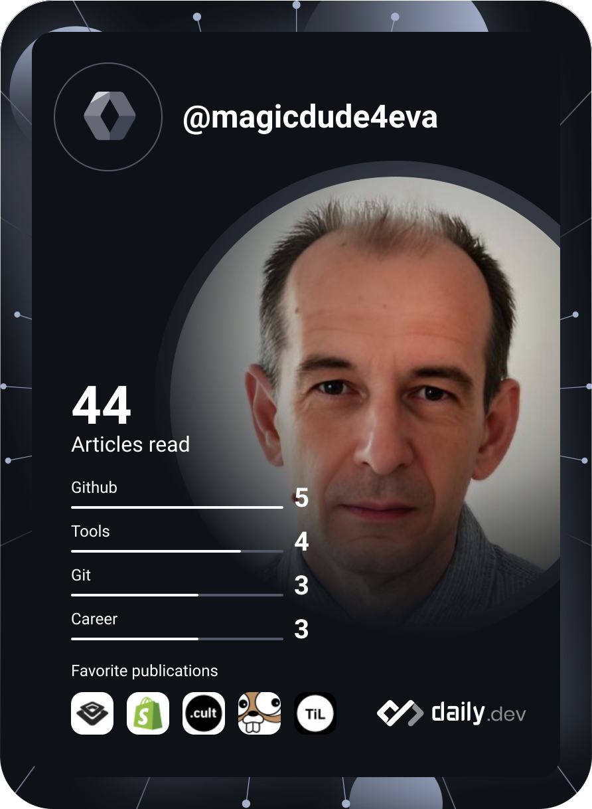

  

 

### Hi there 👋, I'm [Gerd Naschenweng](https://www.linkedin.com/in/gerdnaschenweng/)&nbsp;&nbsp;🚀

**Head of Development / Engineering Manager | Java | DevOps | Agile Leadership | Klagenfurt, Austria**

### 🚀 About Me
With **20+ years in software development and engineering leadership**, I combine hands-on technical depth with strategic leadership to deliver **mission-critical systems** in **public safety, tourism, e-commerce, finance and telecommunications**. I still enjoy getting my hands dirty and can often be found in a Linux terminal or IDE.

As **Head of Department for eOCS Suite Development** at [eurofunk](https://www.eurofunk.com/), I lead **24 developers across 3 agile teams** in Klagenfurt and St. Johann im Pongau, building **eOCS>COM**, the web-based communication module that unifies dispatch, communication and monitoring for emergency control centres.

Recent initiatives at eurofunk:
- **Skill Development Programme (SDP)**: initiated and designed a Dreyfus-model-based programme with career paths, skill matrices, self-assessments and KPIs, now a blueprint across eurofunk departments.
- **Flow over ceremony**: moving teams from SAFe to **flow-based / Kanban** delivery, measured with flow metrics (cycle time, aging, flow efficiency).
- **Full-stack cross-training**: a separate department-wide initiative that turned **33 frontend engineers into full-stack developers within 3 months**, shipping production code.
- **Coding Dojos & mob programming**: developer-led sessions that build a culture of collaboration and experimentation.

### 🛠️ My Skills
#### **Leadership & Management**
✅ **Engineering Management & Team Leadership** (20+ years, teams of up to 34 engineers across 6 teams) 
✅ **Agile Coaching & Transformation** (SAFe → Flow/Kanban, flow metrics) 
✅ **People Development** (skill matrices, career paths, mentoring, Coding Dojos) 
✅ **Strategic Planning, Technical Roadmapping & R&D Budget Ownership** 

#### **Technical Expertise**
💻 **Languages**: Java | TypeScript/JavaScript | Python | Shell/Bash | Ruby | PHP | SQL 
🔧 **Frameworks & Architecture**: Spring Boot | Jakarta EE (J2EE) | Microservices | Clean Architecture | SOA & Integration Hubs | Cloud-Native 
🗄️ **Data & Search**: PostgreSQL (EnterpriseDB) | Oracle | MySQL | IBM DB2 | Elasticsearch | Apache Solr 
⚙️ **DevOps & Infrastructure**: Docker & Compose | Kubernetes | Jenkins | GitLab CI | GitHub Actions | SaltStack | Linux | Xen 
📈 **Observability**: Graylog | Zabbix | New Relic | PagerDuty 
🏠 **Homelab & Side Projects**: Synology | Raspberry Pi | Home Assistant | Bitcoin & Lightning nodes 

#### 🌍 Industry Experience
🚨 **Public Safety**: eurofunk (emergency communication for control centres) 
🏔️ **Tourism & E-Commerce**: Alturos Destinations, Peaksolution™ (**34 engineers, 6 teams, 15+ releases/week, 25+ installations in 5 countries**) 
🛒 **E-Commerce**: bidorbuy.co.za as CTO (Africa’s largest marketplace, **100K orders/day, 3.7M products**) 
📡 **Telecommunications**: Vodacom (**12 call centres, 550 retail franchises, 15K users**) 
🏦 **Banking & Insurance**: First National Bank (**30x capacity, 50 → 1,500 concurrent users**), Standard Bank (350+ branches), VHV Versicherungen, DBV Winterthur 
🚗 **Automotive**: Smart.com (DaimlerChrysler, franchise IT setup) 
🏛️ **Public Sector**: CEDA (Botswana, loan origination systems) 

### 📌 My Projects
Some of my **public projects** (most of my professional work is under NDA):

**Recent work**

| **Project** | **Description** | **Tech Stack** |
|-------------|-----------------|----------------|
| [undertow](https://github.com/magicdude4eva/undertow) | Flow analytics for Jira: exposes **waiting, blocked/stalled aging, queues and flow efficiency** | TypeScript, PostgreSQL, Docker |
| [btc-fullnode-stack](https://github.com/magicdude4eva/btc-fullnode-stack) | Bitcoin full node stack for Synology with **Fulcrum, Mempool and ckpool-solo** | Docker, Bitcoin, Shell |
| [calendar-sync](https://github.com/magicdude4eva/calendar-sync) | Sync ICS feeds into **CalDAV** with emoji mapping, filters and deduplication | Python, Docker |
| [docker-gunbot](https://github.com/magicdude4eva/docker-gunbot) | Minimal glibc-based **Gunbot** crypto trading bot image | Docker, Shell |
| [ha-eg-austria](https://github.com/magicdude4eva/ha-eg-austria) | Home Assistant integration for **EG Austria** energy-community data | Python, Home Assistant |
| [wd-nvme-fw-updater](https://github.com/magicdude4eva/wd-nvme-fw-updater) | Automated **Western Digital NVMe firmware** updater for Linux | Shell, nvme-cli |
| [docker-jirametrics](https://github.com/magicdude4eva/docker-jirametrics) | Scheduled **JiraMetrics** reports for cycle time and flow tracking | Docker, Ruby, Jira API |

**Most popular**

| **Project** | **Description** | **Tech Stack** |
|-------------|-----------------|----------------|
| [iterm-oh-my-zsh-powerlevel10k](https://github.com/magicdude4eva/iterm-oh-my-zsh-powerlevel10k) | Improved terminal experience with **Oh My Zsh, iTerm2 and Powerlevel10k** | Shell, Zsh |
| [port25-bouncehandler](https://github.com/magicdude4eva/port25-bouncehandler) | PowerMTA bounce handler for **Interspire & MailWizz** | PHP, PowerMTA |
| [PiHoleCloudFlareD](https://github.com/magicdude4eva/PiHoleCloudFlareD) | Raspberry Pi ad-blocker with **Pi-hole & cloudflared** | Raspberry Pi, Pi-hole, Cloudflare |
| [graylog-jira-alarmcallback](https://github.com/magicdude4eva/graylog-jira-alarmcallback) | Graylog plugin for **automatic Jira issue creation from alerts** | Java, Graylog, Jira API |

**🔗 [View all my repositories](https://github.com/magicdude4eva?tab=repositories)**

## 📞 Let's Connect!
I’m always open to **collaborating on innovative projects**, **discussing tech trends**, or **exploring new opportunities**. Reach out via any of the links at the top. If my projects save you time, [sponsoring](https://github.com/sponsors/magicdude4eva) is much appreciated.

  
  
  

## Recent activity :zap:
<!--START_SECTION:activity-->
1. 🎉 Merged PR [#5](https://github.com/magicdude4eva/ha-eg-austria/pull/5) in [magicdude4eva/ha-eg-austria](https://github.com/magicdude4eva/ha-eg-austria)
2. 💪 Opened PR [#5](https://github.com/magicdude4eva/ha-eg-austria/pull/5) in [magicdude4eva/ha-eg-austria](https://github.com/magicdude4eva/ha-eg-austria)
3. 🔒 Closed issue [#1](https://github.com/magicdude4eva/btc-fullnode-stack/issues/1) in [magicdude4eva/btc-fullnode-stack](https://github.com/magicdude4eva/btc-fullnode-stack)
4. 🔒 Closed issue [#2](https://github.com/magicdude4eva/btc-fullnode-stack/issues/2) in [magicdude4eva/btc-fullnode-stack](https://github.com/magicdude4eva/btc-fullnode-stack)
<!--END_SECTION:activity-->

## Blog posts
<!-- BLOG-POST-LIST:START -->
- [Energiegemeinschaft EG Austria: Günstiger Ökostrom aus der Region – auch ohne eigene PV-Anlage](https://www.naschenweng.eu/2025/06/05/energiegemeinschaft-eg-austria-gunstiger-okostrom-aus-der-region-auch-ohne-eigene-pv-anlage/)
- [📅 Sync ICS Feeds to Your CalDAV Calendar with Emojis, Deduplication, and Docker](https://www.naschenweng.eu/2025/03/29/%f0%9f%93%85-sync-ics-feeds-to-your-caldav-calendar-with-emojis-deduplication-and-docker/)
- [Get 3 years of Xbox Game Pass Ultimate for under $3/month &lpar;€85 for 3 years&rpar;](https://www.naschenweng.eu/2021/12/20/get-3-years-of-xbox-game-pass-ultimate-for-under-3-month-e85-for-3-years/)
- [Carts full of bling bling – Glitter Mining with VVS and CRO](https://www.naschenweng.eu/2021/11/28/carts-full-of-bling-bling-glitter-mining-with-vvs-and-cro/)
- [Own your own Blockchain NFT-domain forever](https://www.naschenweng.eu/2021/11/15/owning-your-own-block-chain-nft-domain-forever/)
<!-- BLOG-POST-LIST:END -->

  

